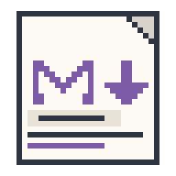
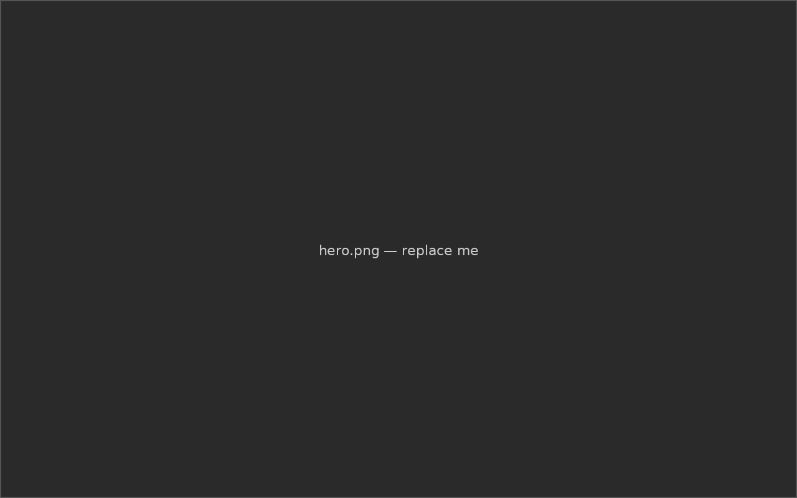
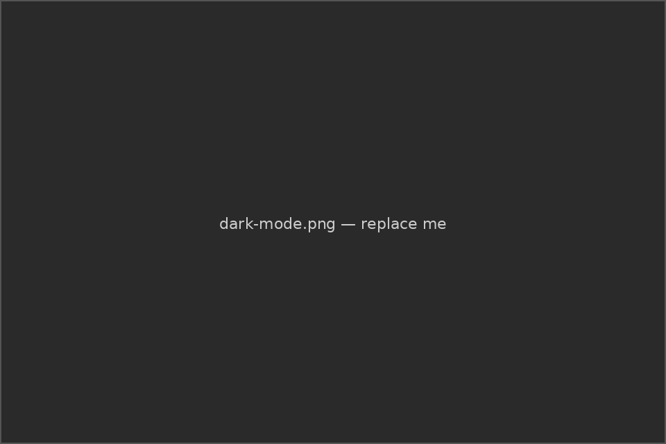
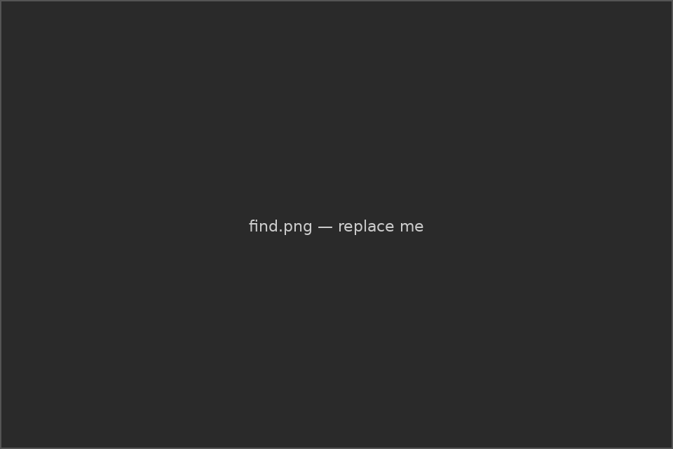
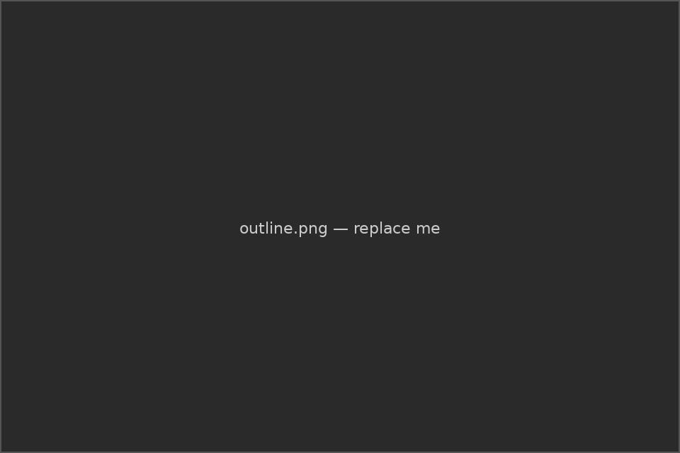
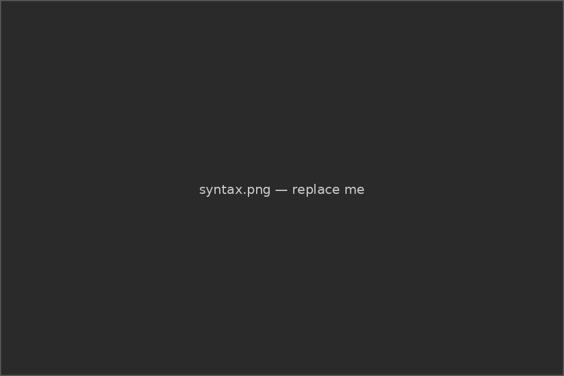

<p align="center">
  
</p>

<h1 align="center">mdview</h1>

<p align="center">
  <strong>A Wayland-native Markdown viewer.</strong><br>
  No Electron. No GTK. No Qt. Just <code>libwayland-client</code> + Cairo + Pango + litehtml + md4c.
</p>

<p align="center">
  <a href="LICENSE"></a>
  
  
  
</p>

<p align="center">
  
</p>

---

## Why mdview

- **Native Wayland.** First-class `xdg-shell`, `wp_cursor_shape_v1`, `xdg-toplevel-icon-v1`, `pointer-gestures-unstable-v1`, `xdg-decoration-unstable-v1`. No XWayland fallback.
- **Frameworkless.** No GTK, Qt, Electron, Tauri, or browser engine. The whole UI is direct Cairo draw calls onto a `wl_shm` buffer.
- **Lightweight stack, surprisingly full app.** Find-in-doc (case / whole-word / regex), async syntax highlighting, dark mode, outline sidebar, live reload, right-click menu, persistent state, HiDPI rendering, pinch zoom, themed cursors, embedded app icon, self-installer — and it all fits in a small C++17 codebase.
- **Drops into any modern Wayland desktop.** GNOME, KDE Plasma, Sway, Hyprland. Only links against libraries already loaded in every Wayland session.

```
  .md file ──▶ md4c (Markdown→HTML) ──▶ litehtml (HTML/CSS→layout) ──▶ Cairo+Pango (render)
                                                                            │
                                                                     ┌──────┘
                                                                     ▼
                                                         libwayland-client + xdg-shell
                                                         (window, input, shared memory)
```

## Showcase

<table>
  <tr>
    <td align="center">
      <br>
      <sub><b>Dark mode.</b> <code>Ctrl+D</code> toggles; syntax-highlight theme swaps too.</sub>
    </td>
    <td align="center">
      <br>
      <sub><b>Find bar.</b> Case / whole-word / regex modes, full text-cursor editing.</sub>
    </td>
  </tr>
  <tr>
    <td align="center">
      <br>
      <sub><b>Outline sidebar.</b> <code>Ctrl+T</code>. h1–h3, click to jump.</sub>
    </td>
    <td align="center">
      <br>
      <sub><b>Async syntax highlighting.</b> Off-thread <code>bat</code> / <code>pygmentize</code> / <code>highlight</code>.</sub>
    </td>
  </tr>
</table>

## Build

### Quick — Podman

```bash
./build.sh
```

Produces `dist/mdview`. The binary is self-contained — icons baked in, no runtime data files.

### Or with system CMake

```bash
sudo apt install libwayland-dev libwayland-cursor0 wayland-protocols libxkbcommon-dev \
                 libcairo2-dev libpango1.0-dev libgdk-pixbuf-2.0-dev librsvg2-dev
cmake -B build -DCMAKE_BUILD_TYPE=Release && cmake --build build
```

Requires CMake ≥ 3.16 and a C++17 compiler.

### Install

```bash
./mdview --install      # writes binary, icons, .desktop entry under ~/.local/
./mdview --uninstall    # undoes the above
```

`--install` is XDG-compliant: binary lands in `~/.local/bin`, icons go under `~/.local/share/icons/hicolor/<size>/apps/`, the `.desktop` file under `~/.local/share/applications/`.

## Usage

```bash
mdview path/to/document.md
```

### Flags

| Flag | Action |
|------|--------|
| `--no-highlight` | Disable syntax highlighting of code blocks |
| `--no-reload` | Disable live-reload on file change |
| `-f` / `--foreground` | Stay attached to the launching terminal |
| `--install` | Install binary + icons + `.desktop` under `~/.local/` |
| `--uninstall` | Undo `--install` |
| `-h` / `--help` | Show usage |

Also: `MDVIEW_NO_HIGHLIGHT=1` env var to suppress syntax highlighting globally.

### Keyboard

| Key | Action |
|-----|--------|
| `j` / `↓` | Scroll down |
| `k` / `↑` | Scroll up |
| `Space` / `PageDown` | Page down |
| `Shift+Space` / `PageUp` | Page up |
| `g` / `Home` | Top of document |
| `G` / `End` | Bottom of document |
| `Ctrl+C` | Copy selection to clipboard |
| `Ctrl+A` | Select all text |
| `Ctrl+F` | Open find bar |
| `Enter` / `F3` | Next match (while find bar is open) |
| `Shift+Enter` / `Shift+F3` | Previous match |
| `Alt+C` / `Alt+W` / `Alt+R` | Toggle case-sensitive / whole-word / regex (in find bar) |
| `Ctrl+Backspace` | Delete word (in find bar) |
| `Ctrl++` / `Ctrl+=` | Increase text size (reflows) |
| `Ctrl+-` | Decrease text size |
| `Ctrl+0` | Reset text size + zoom |
| `Ctrl+T` | Toggle outline (TOC) sidebar |
| `Ctrl+D` | Toggle dark mode |
| `F1` / `?` | Toggle help overlay |
| `q` | Quit |
| `Escape` | Close find / help / context menu (doesn't quit) |

### Mouse

- **Wheel** — scroll
- **Shift+wheel** — horizontal scroll
- **Ctrl+wheel** — zoom
- **Pinch (touchpad)** — zoom
- **Click + drag** — select text · **double-click** word · **triple-click** line
- **Click on link** — open in browser, or scroll to `#anchor`
- **Right-click** — context menu (Open Link / Copy / Select All / Find / Reload / Toggle Dark)
- **Title bar drag** — move window (CSD mode) · **double-click** to toggle maximize

## Configuration

mdview keeps two files under `~/.config/mdview/`:

- **`state`** — machine-managed. Per-file scroll / zoom / text-size LRU (hashed paths, last 20 files), last window size, dark mode, search flags. Rewritten on every close — don't edit by hand.
- **`config`** — user-editable. Defaults for newly-opened files only; the LRU always wins for files you've already adjusted. Optional — if missing, built-in defaults apply.

```ini
# ~/.config/mdview/config
font_size = 16    # body font-size in px (8..48)
zoom      = 1.0   # pinch-zoom level, 1.0 = 100% (1.0..5.0)
```

`#` comments and whitespace around `=` are tolerated.

## Window decorations

mdview negotiates server-side decorations via `xdg-decoration-unstable-v1`. Compositors that support it (KDE Plasma, Sway, Hyprland, …) draw their own title bar. If the compositor doesn't support the protocol or requests client-side decorations (e.g. GNOME/Mutter), mdview draws a minimal dark title bar with a close button.

## Runtime dependencies

Only libraries already loaded in any Wayland session:

| Library | Why |
|---|---|
| `libwayland-client.so` | Wayland protocol |
| `libwayland-cursor.so` | Cursor theme — only loaded on compositors without `wp_cursor_shape_v1` |
| `libxkbcommon.so` | Keyboard layout & keysyms |
| `libcairo.so` | 2D rendering |
| `libpangocairo-1.0.so` / `libpango-1.0.so` | Text shaping & layout |
| `libgdk_pixbuf-2.0.so` | Image loading |
| `librsvg-2.0.so` | SVG rendering |

## License

mdview is MIT-licensed — see [LICENSE](LICENSE).

Bundled / linked dependencies:

| Component | License |
|---|---|
| litehtml | BSD-3-Clause |
| md4c | MIT |
| Cairo, Pango, Wayland | LGPL |
